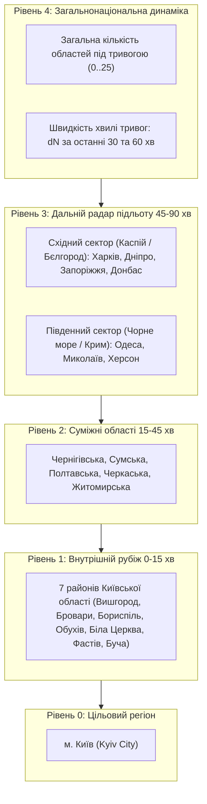
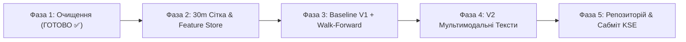

# Архітектурний план реалізації: Прогнозування тривог для м. Київ (SirenCast UA)

> **Ціль проєкту:** Модель прогнозування ймовірності початку повітряної тривоги для м. Київ (Kyiv City) на 30-хвилинному горизонті із запобіганням витоку даних (No Data Leakage).
> **Поточний статус:** 
> - **Фаза 1 завершена успішно ✅** (Дані очищено, 113k дублікатів видалено, тести пройдені, Parquet згенеровано).
> - **Фаза 2 завершена успішно ✅** (Сітка 30m згенерована, 77 колонок 4 рівнів радара, 64 561 крок, нуль витоку даних, тести пройдено).
> - **На черзі:** Фаза 3 (Baseline V1 та Walk-Forward бектестинг).

---

## 1. Фактчекінг та результати Фази 1 (Очищення даних) — ЗАВЕРШЕНО ✅

Під час технічного аналізу `official_data_en.csv` було виявлено механічну склейку двох дампів всередині одного файлу (починаючи з рядка 113913 дані починалися знову з 2022 року).

### Результати очищення:
* **Початкова кількість рядків:** 299,275
* **Видалено точних дублікатів:** **113,845 рядків (38.04%)**
* **Очищений датасет:** **185,430 рядків**
* **Часовий діапазон:** 2022-03-15 16:10:34 UTC — 2026-09-07 05:28:22 UTC
* **Аномалії тривалості ($t_{\text{end}} < t_{\text{start}}$):** 0
* **Пропущені дати:** 0
* **Збережений артефакт:** `data/processed/clean_alerts.parquet` (розмір зменшено з 31 МБ до 3.4 МБ).
* **Автоматичні тести:** Модуль `tests/test_data_loader.py` перевірив відсутність дублікатів, валідність UTC таймстемпів та повне просторове покриття всіх 25 областей та 7 районів Київщини. Усі 6 тестів пройдено успішно.

---

## 2. Результати Фази 2 (30m Сітка та Feature Store) — ЗАВЕРШЕНО ✅

* **Параметри сітки:** Регулярний часовий ряд з кроком 30 хвилин з 2023-01-01 до 2026-09-07 (64 561 півгодинний крок).
* **Розмірність матриці:** **64 561 рядків $\times$ 77 колонок**.
* **Цільова змінна ($y_t$ — старт тривоги в Києві в наступні 30 хв):**
  * Загальна кількість початку тривог: **1 753 події (2.72% позитивний клас)**.
  * У спокійні періоди (коли в Києві тихо в момент $t$): 1 707 початку тривог (2.83%).
* **Просторові рівні радара:**
  * Рівень 0: локальний Київ (тиша, тривалість поточної сирени, сумарні тривоги за 6 та 24 години).
  * Рівень 1: 7 районів Київщини (активність, лаги $t-30\text{m}$, $t-60\text{m}$, сумарна кількість, нові запуски).
  * Рівень 2: 5 суміжних областей (активність, лаги $t-30\text{m}$, $t-60\text{m}$).
  * Рівень 3: Східний та Південний фланги (Каспійський вектор та Чорноморський вектор з лагами до $t-90\text{m}$).
  * Рівень 4: Загальнонаціональна макро-хвиля (кількість областей $N \in [0, 25]$ та швидкість наростання $\Delta N$).
  * Циклічний час: $\sin/\cos$ для години доби та дня тижня.
* **Збережений артефакт:** `data/processed/features_30m.parquet` (1.9 МБ).
* **Контроль відсутності витоку даних (No Leakage Guarantee):**
  * Модуль `tests/test_features_causality.py` програмно верифікував лагову строгість (`assert lag[1:] == unlagged[:-1]`), фізичні межі просторових сум та одиничне коло для $\sin/\cos$. Усі тести пройдені.

---

## 3. Постановка задачі: Імовірнісне прогнозування (Probabilistic Forecasting)

* **Цільовий регіон (Target):** `Kyiv City` (Київ).
* **Дискретизація часу ($\Delta t$):** **30 хвилин**. Таймлайн розбивається на регулярні півгодинні біни ($t_0, t_1, t_2, \dots$).
* **Цільова змінна ($y_t \in \{0, 1\}$):**
  * *Постановка Onset Prediction:* Якщо в момент $t$ у Києві **немає активної тривоги**, чи розпочнеться нова тривога в інтервалі $[t, t + 30\text{min}]$?
  * *Постановка Active State:* Чи буде в інтервалі $[t, t + 30\text{min}]$ активна або розпочнеться тривога в Києві?
  * *Основний фокус:* **Onset Prediction** (завчасне попередження про початок небезпеки), оскільки це становить найбільшу цінність для цивільної безпеки та оперативного реагування.
* **Вихід моделі (Probabilistic Output):**
  $$\hat{p}_t = P(y_t = 1 \mid X_t) \in [0, 1]$$
  Модель повертає калібровану ймовірність початку тривоги в найближчі 30 хвилин.
* **Вхідні дані на момент $t$ ($X_t$):** Виключно стан сирен та подій строго до моменту $t$ ($t_{\text{event}} < t$).

---

## 3. Просторова структура ознак: Багаторівневий радар підльоту

Враховуючи реальні траєкторії атак (пуски стратегічної авіації з Каспійського моря / Енгельса, балістика з Бєлгорода/Курська, пуски "Калібрів" з Чорного моря та "Шахедів" з Приморсько-Ахтарська/Криму), ми формуємо **4-рівневий просторовий радар**:

---

## 4. Детальний опис наступних фаз проєкту

---

### ФАЗА 2: Побудова 30-хвилинної сітки та Feature Store (Наступний крок)

#### 2.1. Генерація часової сітки (Timeline Discretization)
1. Створюємо регулярний часовий ряд `pd.date_range(start='2023-01-01 00:00:00+00:00', end='2026-09-07 00:00:00+00:00', freq='30min')`.
2. Для кожного півгодинного слота $[t, t + 30\text{min}]$:
   * Визначаємо, чи була активна тривога в Києві в момент $t$ (`kyiv_active_now`).
   * Розраховуємо таргет $y_t$: чи розпочалася нова тривога в Києві в інтервалі $[t, t + 30\text{min}]$.

#### 2.2. Розрахунок ознак за рівнями просторового радара (Strictly Causal):
* **Рівень 0 (Київ — локальна історія):**
  * `kyiv_time_since_last_alert_hours`: скільки годин минуло від закінчення останньої тривоги.
  * `kyiv_alert_count_last_6h`, `12h`, `24h`, `48h`: кількість тривог за попередні вікна.
  * `kyiv_alert_duration_last_6h`, `12h`, `24h`: сумарна тривалість сирен за вікна.
* **Рівень 1 (Внутрішній рубіж — 7 районів Київщини):**
  * 7 бінарних прапорців: чи активна тривога в кожному з районів у момент $t$ (`vyshhorod_active`, `brovary_active`, `boryspil_active`, `obukhiv_active`, `bila_tserkva_active`, `fastiv_active`, `bucha_active`).
  * Лаги на $t-30\text{m}$ та $t-60\text{m}$.
  * `inner_ring_active_count`: сума районів під тривогою прямо зараз ($0 \dots 7$).
  * `inner_ring_new_alerts_last_30m`: скільки районів увімкнули сирену за останні 30 хвилин.
* **Рівень 2 (Суміжний рубіж — 5 сусідніх областей):**
  * Бінарні статуси для Чернігівської, Сумської, Полтавської, Черкаської, Житомирської областей на $t, t-30\text{m}, t-60\text{m}$.
  * `adjacent_active_count`: кількість сусідніх областей під тривогою ($0 \dots 5$).
* **Рівень 3 (Дальній радар — Східний та Південний сектори):**
  * Східний вектор (Харківська, Дніпропетровська, Запорізька, Донецька): пуски крилатих ракет з Каспію або східні групи дронів. Лаги: $t, t-30\text{m}, t-60\text{m}, t-90\text{m}$.
  * Південний вектор (Одеська, Миколаївська, Херсонська): морські пуски та південні дрони. Лаги: $t, t-30\text{m}, t-60\text{m}, t-90\text{m}$.
* **Рівень 4 (Макро-хвиля по всій Україні):**
  * $N_{\text{active}}(t)$: загальна кількість областей під тривогою прямо зараз ($0 \dots 25$).
  * Швидкість наростання хвилі: $\Delta N_{30\text{m}} = N_{\text{active}}(t) - N_{\text{active}}(t-30\text{m})$, $\Delta N_{60\text{m}} = N_{\text{active}}(t) - N_{\text{active}}(t-60\text{m})$.
* **Календарні фактори:**
  * Циклічний час: $\sin(2\pi \cdot \text{hour} / 24)$, $\cos(2\pi \cdot \text{hour} / 24)$.
  * Циклічний день тижня: $\sin(2\pi \cdot \text{dow} / 7)$, $\cos(2\pi \cdot \text{dow} / 7)$.

#### 2.3. Збереження та контроль якості:
* Модуль `src/features_ts.py` генерує та зберігає `data/processed/features_30m.parquet`.
* Тест на відсутність витоку даних: `tests/test_features_causality.py` програмно перевіряє, що жодна ознака в рядку $t$ не використовує дані з міткою $\ge t$.

---

### ФАЗА 3: Baseline V1 Моделювання та Walk-Forward бектестинг

#### 3.1. Модельний стек (`src/models.py`):
1. **Heuristic Baseline (Евристика ППО):**
   * Правило: якщо $\ge 2$ райони Київської області або Чернігівська/Сумська область під тривогою, і тривога наростає $\to \hat{p} = 0.85$, інакше базовий рівень.
2. **Logistic Regression (L2-Regularized):**
   * Нормалізація ознак (`StandardScaler`), ваги класів (`class_weight='balanced'`).
3. **LightGBM Classifier (Основна модель V1):**
   * Цільова функція: `binary_logloss`.
   * Налаштування параметрів: `num_leaves=31`, `learning_rate=0.03`, `n_estimators=300`, `min_child_samples=50`, `scale_pos_weight` для компенсації дисбалансу класів.
   * Отримання каліброваних ймовірностей через `predict_proba`.

#### 3.2. Динамічний Walk-Forward бектестинг (`src/evaluate.py`):
Щоб врахувати еволюцію тактик обстрілів за сезонами:
* **Фолд 1:** Навчання: 2023-01 — 2025-12. Тест: **2026 Q1 (Січень — Березень 2026)**.
* **Фолд 2:** Навчання: 2023-01 — 2026-03. Тест: **2026 Q2 (Квітень — Червень 2026)**.
* **Фолд 3:** Навчання: 2023-01 — 2026-06. Тест: **2026 Q3 (Липень — Вересень 2026)** (Фінальний найсвіжіший період).

#### 3.3. Метрики та артефакти:
* **PR-AUC (Precision-Recall Area Under Curve):** ключова метрика для незбалансованих рідкісних подій.
* **ROC-AUC:** загальна здатність ранжування ризику.
* **Brier Score:** точність самих передбачених ймовірностей ($MSE$ між $\hat{p}_t$ та $y_t$).
* **Precision / Recall / F1** при практичних порогах відсікання ($p > 0.20, 0.35, 0.50$).
* **Візуалізація:** Генерація графіків у `.agents/artifacts/`:
  * `pr_curve_comparison.png`
  * `reliability_calibration_curve.png`
  * `feature_importance_ranking.png` (оцінка реального внеску Каспійського, Східного та Внутрішнього рубежів).

---

### ФАЗА 4: V2 Мультимодальне покращення (Текстові дані)

#### 4.1. Джерело та препроцесинг текстів:
* Використання публічних офіційних повідомлень Повітряних Сил ЗСУ / моніторингових зведень із фіксованими часовими мітками публікації $t_{\text{msg}}$.
* **Суворий бар'єр проти Data Leakage:** У півгодинний бін $t$ потрапляють ТІЛЬКИ повідомлення, де $t_{\text{msg}} < t$. Повідомлення, опубліковані під час прогнозованого вікна, суворо відкидаються.

#### 4.2. Векторизація тексту (`src/features_text.py`):
1. **Rule-based NLP тригери:**
   * Детекція типів загроз за ключовими категоріями:
     * `threat_shahed`: "шахед", "бпла", "дрон", "мопед".
     * `threat_strategic_aviation`: "ту-95", "ту-22", "каспій", "енгельс", "пуск крилатих".
     * `threat_mig_kinzhal`: "міг-31к", "кинджал", "саваслейка".
     * `threat_ballistic`: "балістика", "іскандер", "бєлгород".
     * `direction_kyiv`: "у напрямку києва", "на білу церкву", "на васильків", "через чернігівщину".
2. **Dense Semantic Embeddings:**
   * Кодування тексту легким трансформером (наприклад, `paraphrase-multilingual-MiniLM-L12-v2`) або TF-IDF N-грам.

#### 4.3. Late Fusion без ризику Integration Hell:
* Конкатенація ознак: $X_{\text{multimodal}}(t) = [X_{\text{ts}}(t), X_{\text{text}}(t)]$.
* Порівняння результатів на одному й тому самому Walk-Forward тестовому сеті:
  $$\Delta \text{PR-AUC} = \text{PR-AUC}_{\text{V2}} - \text{PR-AUC}_{\text{V1}}$$
  $$\Delta \text{Brier} = \text{Brier}_{\text{V2}} - \text{Brier}_{\text{V1}}$$

---

### ФАЗА 5: Фіналізація, документація та сабміт до KSE

#### 5.1. Структура репозиторію та код:
* Очищений репозиторій з чіткою структурою у `src/`.
* `run_experiment.py` — головний скрипт, який запускає повний цикл (завантаження даних, генерацію фіч, навчання бейзлайнів, валідацію, генерацію звітів та графіків) за одну команду.
* `README.md` з інструкцією швидкого запуску (Quickstart), таблицею метрик та описом архітектури.

#### 5.2. Вимоги KSE:
1. **Працюючий GitHub репозиторій** з відтворюваним кодом.
2. **AI interaction log:** `ai_usage.md` (автоматично оновлюється під час роботи).
3. **Reflection (~100 слів):** фактологічний опис трьох запитань (What went wrong? How did you adjust? Why is final version better?) на основі реальних отриманих експериментальних метрик.
