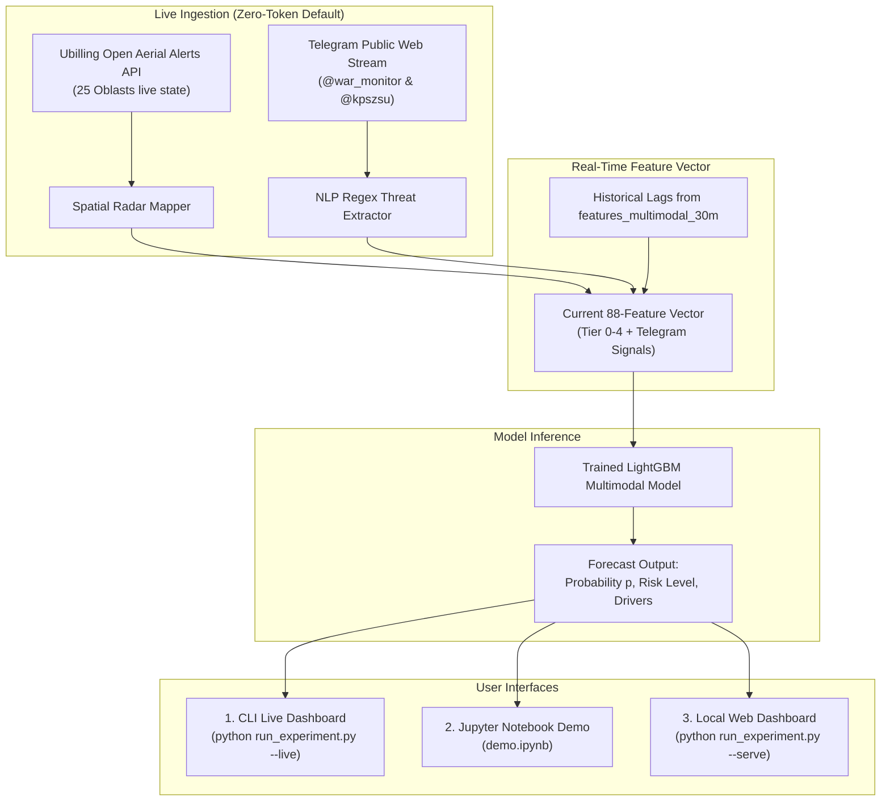

# Implementation Plan: Live Forecasting Suite (CLI, Jupyter Notebook & Local Web Dashboard)

This plan extends **SirenCast UA** beyond retrospective backtesting into **real-time live inference**, enabling anyone cloning the repository to run live 30-minute alert probability forecasts for Kyiv City using current physical sirens and live Telegram warnings.

---

## 🎯 Goal Description

Build a live inference extension comprising:
1. **Live Data Ingestion Engine (`src/live_data.py`):**
   * **Real-time Sirens:** Pull active alert states across all 25 Ukrainian oblasts and Kyiv City using the open API (`https://ubilling.net.ua/aerialalerts/`). Strict rate limiting hygiene: adhere to the API's 2 RPS limit by implementing an in-memory client-side cache with minimum 5-second TTL (default polling 10–15s), preventing HTTP 429.
   * **Real-time Telegram:** Pull the latest live messages from `@war_monitor` and `@kpszsu` using public channel web previews (`https://t.me/s/war_monitor` and `https://t.me/s/kpszsu`). **Zero-config, zero tokens, no .env required** — runs out of the box for anyone.
2. **Real-time Feature Synthesizer & Predictor (`src/live_forecast.py`):**
   * Pre-trains/loads the best calibrated LightGBM model.
   * Maps current siren states into the 4-tier spatial radar (Tier 0 Kyiv, Tier 1 Inner Ring, Tier 2 Bordering Oblasts, Tier 3 Launch Corridors, Tier 4 National Surge).
   * Runs the causal NLP extractor on recent live Telegram messages.
   * Outputs calibrated probability formatted as **percentage** (e.g., **`48.2%`**), threat severity label (LOW / ELEVATED / HIGH / CRITICAL), and key threat drivers.
3. **Interactive Demonstrations (The Trifecta — to be documented in `README.md`):**
   * **CLI Live Dashboard:** `python run_experiment.py --live` (live polling terminal dashboard with percentage gauge).
   * **Jupyter Notebook:** `demo.ipynb` (clean, interactive walkthrough with visual percentage gauge, radar tier breakdown, and interactive What-If scenario simulator).
   * **Lightweight Web UI:** `python run_experiment.py --serve` (zero-dependency Python standard library HTTP server hosting a sleek dark-mode dashboard at `http://localhost:8000`).

---

## 👥 User Feedback Incorporated

> [!IMPORTANT]
> **API Rate Limiting & Zero Credentials:**
> - Ubilling API enforces a strict limit of 2 requests/second. We implement a thread-safe client cache with 5s TTL to guarantee rate compliance.
> - Completely removed bot tokens and `.env` requirements. All Telegram data is sourced from public previews, making the pipeline 100% zero-config.
> - Probabilities are formatted as intuitive percentages (e.g. `24.5%`) with visual meters across all interfaces.
> - The Trifecta (CLI, Notebook, Web) will be prominently documented in `README.md`.

> [!NOTE]
> **GitHub Pages vs Local Web Dashboard:**
> GitHub Pages only hosts static client-side files (HTML/JS) and cannot run Python/LightGBM or fetch Telegram due to browser CORS policies. A local dashboard served via `python run_experiment.py --serve` (built entirely with Python's built-in `http.server` — zero new dependencies!) provides a responsive local web UI at `http://localhost:8000` with direct access to model inference.

---

## 📐 Architecture & Flow

---

## 🛠️ Proposed Changes

### Core Live Engine (`src/`)

#### [NEW] `src/live_data.py`
* `fetch_live_aerial_alerts() -> dict`: Queries `https://ubilling.net.ua/aerialalerts/` to get current boolean alert states for all regions.
* `fetch_live_telegram_messages(limit: int = 20) -> list[dict]`: Scrapes latest messages with timestamps and channels from `https://t.me/s/war_monitor` and `https://t.me/s/kpszsu` without API keys.
* Robust error handling and fallback to synthetic simulation if internet is unavailable.

#### [NEW] `src/live_forecast.py`
* `build_live_feature_vector()`: Combines live alerts + live telegram with recent historical feature lags.
* `predict_live_risk()`: Loads trained LightGBM model, computes calibrated probability $\hat{p}$, risk band, and feature attribution.
* Formatted terminal output for CLI mode.

#### [NEW] `src/web.py`
* Standard library `http.server` backend with a JSON endpoint (`/api/forecast`).
* Zero external web framework dependencies (no Flask/FastAPI required).
* Serves `web/index.html`.

#### [NEW] `web/index.html`
* Clean, standalone dark-mode dashboard (HTML/CSS/JS).
* Real-time radial probability gauge (SVG).
* 4-Tier Spatial Radar status grid.
* Recent live Telegram threat ticker.

---

### Interactive Notebook & CLI

#### [NEW] `demo.ipynb`
* Clean, well-commented Jupyter Notebook for demonstration and grading.
* Step 1: Model loading & baseline inspection.
* Step 2: One-click live forecasting (`predict_live_risk()`).
* Step 3: Interactive **What-If Simulation** (e.g. inject simulated Shahed swarm on Chernihiv / missile takeoff to see probability spike).

#### [MODIFY] `run_experiment.py`
* Add `--live` flag to launch the live polling CLI dashboard.
* Add `--serve` flag to launch the local web server at `http://localhost:8000`.

---

## 🧪 Verification Plan

### Automated Tests
* Create `tests/test_live_data.py`:
  - Unit test alert parser against mocked response.
  - Unit test telegram message scraper against sample HTML.
  - Test live feature vector assembly and model inference shape.
* Command: `python run_experiment.py --test`

### Manual Verification
1. Run `python run_experiment.py --live`: verify live terminal dashboard prints active regions and calibrated probability.
2. Run `python run_experiment.py --serve`: open `http://localhost:8000` in browser, verify radial gauge and radar view.
3. Open `demo.ipynb`: execute all cells sequentially, verify visual outputs and what-if simulation.
