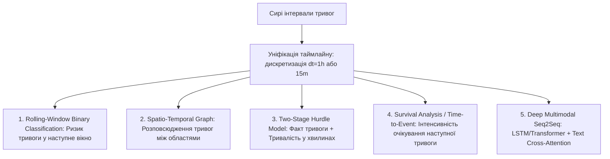
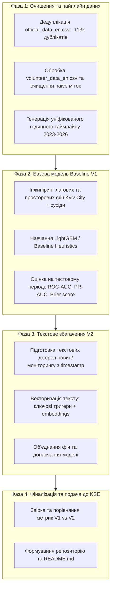

# Архітектурний план реалізації: Прогнозування повітряних тривог (SirenCast UA) [Версія 1 - Початкова]

> **Контекст проєкту:** Відбірковий проєкт до **KSE Agentic AI School (Stage 2)**.
> **Дедлайн:** Понеділок, 12 жовтня 2026, 23:59 (EEST).
> **Ключовий фокус оцінювання:** Якість інженерного процесу, відсутність Data Leakage, робоча взаємодія з AI та чітка еволюція від базової версії до покращеної з текстом.

---

## 1. Огляд задачі та глибинний аудит даних

### 1.1. Суть завдання
Створити часорядну (time series) модель прогнозування повітряних тривог для обраного регіону України (або мультирегіональну) на найсвіжіших даних без data leakage (усі вхідні дані на момент прогнозу $t$ повинні строго передувати $t$). Додатково (optional, але критично для високого балу) збагатити модель текстовими даними (наприклад, повідомлення Повітряних Сил / моніторингових каналів).

### 1.2. Виявлені аномалії та підводні камені в наданих датасетах

Ми провели первинний аудит файлів `data/official_data_en.csv` та `data/volunteer_data_en.csv`. Було виявлено критичні проблеми, які здатні зруйнувати навчання, якщо їх не врахувати:

| Характеристика | `official_data_en.csv` | `volunteer_data_en.csv` | Ризик / Висновок |
| :--- | :--- | :--- | :--- |
| **Кількість рядків** | 299,275 рядків | 115,793 рядків | Різні джерела та охоплення |
| **Дублікати** | **113,845 дублікатів (~38%)!** | **0 дублікатів** | В офіційному датасеті є ідентичні рядки (наприклад, подвоєні записи для одних і тих самих тривог). Їх обов'язково треба видалити (`drop_duplicates`). |
| **Часовий діапазон** | 2022-03-15 — **2026-09-07** | 2022-02-25 — **2026-10-10** (до сьогодні!) | Офіційний датасет відстає на місяць, волонтерський містить найсвіжіші дані жовтня 2026 року. |
| **Рівні тривог (Granularity)** | `oblast` (130k), `raion` (132k), `hromada` (36k) | Тільки рівень області (`region`) | **Критичний зсув (Data Drift) у 2026 році:** в офіційному датасеті за 2026 рік майже всі тривоги переведені на рівень районів (79,045 `raion` проти лише 503 `oblast`). Якщо просто відфільтрувати `level == 'oblast'`, модель подумає, що тривоги у 2026 році зникли! |
| **Аномалії 'naive'** | Відсутні | 5,791 рядок має `naive == True` | Усі наївні записи мають штучну тривалість рівно **1800 секунд (30 хв)** — це артефакт, коли бот не зафіксував відбій і підставив дефолтний час. Їх не можна використовувати для навчання моделі тривалості відбою. |

---

## 2. 5 способів реалізувати задачу

Нижче наведено 5 різних архітектурних постановок задачі:



### Варіант 1 (Рекомендований): Дискретизована бінарна класифікація у ковзному вікні (Rolling-Window Binary Classification)
* **Постановка:** Розбиваємо таймлайн на рівні інтервали (наприклад, 1 година або 30 хвилин). Для кожного моменту часу $t$ цільова змінна $y_t \in \{0, 1\}$ — чи розпочнеться (або чи буде активною) тривога в цільовому регіоні у проміжку $[t, t + \Delta t]$ (наприклад, протягом найближчих 1-2 годин).
* **Модель:** Gradient Boosted Decision Trees (LightGBM / CatBoost).
* **Ознаки:**
  * Лагові стани тривоги в цільовому та сусідніх регіонах ($t-1\text{h}, t-3\text{h}, t-6\text{h}, t-24\text{h}$).
  * Ковзні суми тривалості тривог за останні 6, 12, 24, 48 годин, 7 днів.
  * Час, що минув з моменту закінчення останньої тривоги.
  * Календарні та циклічні фактори: година доби ($\sin/\cos$), день тижня, місяць.
* **Переваги:** Максимальна стабільність, легка інтерпретованість (Feature Importance / SHAP), чіткі метрики (ROC-AUC, PR-AUC, F1, LogLoss), нульовий ризик integration hell при додаванні тексту.

---

### Варіант 2: Просторово-часова модель поширення тривог (Spatio-Temporal Graph / Neighbor-Lag Model)
* **Постановка:** Моделювання фізики та балістики повітряних нальотів (Шахеди та ракети летять через південні/східні області у напрямку центру та заходу). Вхідний вектор містить статус усіх 25 областей одночасно.
* **Модель:** Spatio-Temporal Graph Convolutional Network (ST-GCN) або спрощений варіант: LightGBM з явними графовими ознаками (наприклад, матриця суміжності кордонів областей та вектори напрямків загрози).
* **Переваги:** Відповідає реальній природі загрози — наприклад, якщо тривога в Одеській та Миколаївській областях вже 40 хвилин, імовірність тривоги у Вінницькій чи Черкаській зростає в рази.
* **Складність:** Потребує матриці сусідства або відстаней між областями.

---

### Варіант 3: Двоетапна Hurdle-модель (Факт початку + Прогнозування тривалості)
* **Постановка:**
  * *Етап 1 (Класифікація):* Чи увімкнеться сирена протягом наступних 2 годин?
  * *Етап 2 (Регресія, обумовлена спрацюванням Етапу 1):* Якщо сирена увімкнулася, скільки хвилин вона триватиме? (наприклад, 20 хв для зльоту МіГ-31К проти 3.5 годин для масованої атаки БПЛА).
* **Модель:** LightGBM Classifier + LightGBM Regressor (або Quantile Regression для довірчих інтервалів).
* **Переваги:** Найвища практична цінність для цивільної оборони та бізнесу.

---

### Варіант 4: Аналіз виживання / Time-to-Event (Survival Analysis / Hazard Rate)
* **Постановка:** Для кожного моменту часу моделюється ймовірність "дожиття" без тривоги $S(t) = P(T > t)$ або функція ризику $h(t)$ (hazard rate).
* **Модель:** Cox Proportional Hazards, Weibull AFT, або DeepSurv.
* **Переваги:** Природно працює з неперервним часом між подіями (inter-arrival times).
* **Недоліки:** Складніша для швидкої інтеграції динамічних зовнішніх текстових ознак за 2 дні.

---

### Варіант 5: Глибока мультимодальна послідовна модель (Multimodal LSTM / Temporal Fusion Transformer)
* **Постановка:** Нейромережа, яка приймає послідовність часових рядів за останні $K$ кроків разом із текстовими ембедингами новинних повідомлень через механізм Cross-Attention.
* **Модель:** Temporal Fusion Transformer (TFT) або GRU з текстовим енкодером (MiniLM / RoBERTa).
* **Переваги:** Сучасний Deep Learning підхід.
* **Недоліки:** Ризик оверфітингу на розріджених подіях, довге навчання, висока ймовірність застрягти у налаштуванні нейромережі перед дедлайном.

---

## 3. Як уникнути "Integration Hell" при переході Base (TS) $\to$ Multimodal (TS + Text)

При правильній модульній архітектурі перехід від базової моделі до текстової є простим:

```mermaid
flowchart LR
    subgraph TimeGrid [Фіксована часова сітка t_0, t_1, ..., t_N]
        Grid[Регулярні біни: наприклад, кожна 1 година]
    end

    subgraph FeatureStore [Модульні генератори ознак]
        TS_Ext[TS Feature Extractor: лаги, ковзні вікна, час] --> X_ts["X_ts (N x d1)"]
        Text_Ext[Text Feature Extractor: TF-IDF / Embeddings за вікно [t-w, t]] --> X_text["X_text (N x d2)"]
    end

    Grid --> TS_Ext
    Grid --> Text_Ext

    subgraph Models [Експерименти]
        X_ts --> Base["Версія 1 (Baseline): Model(X_ts)"]
        X_ts & X_text --> Multi["Версія 2 (Multimodal): Model(concat[X_ts, X_text])"]
    end
```

### Принципи уникнення integration hell:
1. **Єдина часова сітка (Unified Time Index):**
   Обидва пайплайни спираються на одну й ту саму регулярну індексацію часу `datetime_index` (наприклад, крок 1 година з початку 2024 по жовтень 2026).
2. **Формат конкатенації колонок (Late Fusion / Feature Level):**
   * Базова версія навчається на матриці $X_{\text{ts}} \in \mathbb{R}^{N \times D_1}$.
   * Текстовий пайплайн бере повідомлення за проміжок $[t - 1\text{h}, t]$, рахує ембединг (наприклад, через легку українську/багатомовну модель або базовий TF-IDF ключових слів типу "шахед", "пуск", "зліт", "вибух") $\to X_{\text{text}} \in \mathbb{R}^{N \times D_2}$.
   * Мультимодальна версія — це просто `pd.concat([X_ts, X_text], axis=1)`. Базовий код навчання, валідації та метрик залишається на 100% незмінним.

---

## 4. Вибір регіону для прогнозування

> [!TIP]
> **Рекомендований цільовий регіон: `Kyiv City` (Київ)**
> **Чому:**
> 1. Не має конфліктів розбиття на райони/громади (єдина адміністративна зона в обох датасетах).
> 2. Стратегічно найважливіший об'єкт захисту України.
> 3. До Києва засоби нападу зазвичай летять через сусідні регіони (Чернігівська, Сумська, Київська, Полтавська, Черкаська), що створює ідеальні сильні лагові та просторові сигнали для моделі.

---

## 5. Захист від витоку даних (No Data Leakage Policy)

Згідно з інструкцією в `task.md`:
> *"Make sure there is no data leakage: nothing your model is trained on or uses as an input may come from after the time at which the forecast is made."*

Ми закладаємо суворі правила:
1. **Тільки TimeSeriesSplit / Temporal Holdout:**
   * **Train:** дані з 2023-01-01 до 2026-06-30.
   * **Validation:** 2026-07-01 до 2026-08-31.
   * **Test (Latest Period):** 2026-09-01 до 2026-10-10 (найсвіжіші дані волонтерського датасету).
   * Жодного випадкового `train_test_split(shuffle=True)`!
2. **Causal Rolling Features:**
   Усі лаги, суми та середні рахуються строго закритими зліва `closed='left'` або `shift(1)`.
3. **Temporal Text Gate:**
   Текстові повідомлення для прогнозу в точці $t$ беруться тільки з часовою міткою $t_{\text{msg}} < t$.

---

## 6. Покроковий план розробки



---

## 7. Питання для узгодження з користувачем

1. **Вибір цільового регіону:** Чи погоджуєтесь ви взяти **Kyiv City** як основний цільовий регіон?
2. **Горизонт прогнозу:** Чи підходить прогноз на **наступну 1 годину** чи 30 хвилин?
3. **Текстові дані:** Яке джерело текстових даних плануємо використати для V2?
