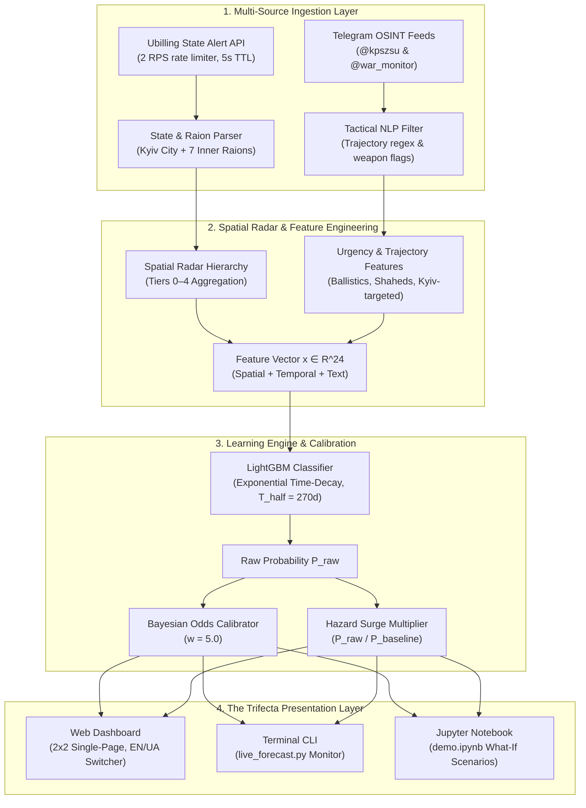

# SirenCast UA: Probabilistic Air Raid Alert Forecasting for Kyiv City

[](https://www.python.org/)
[](https://opensource.org/licenses/MIT)
[](docs/specs.md)

**SirenCast UA** is an end-to-end machine learning system that forecasts air raid alert probabilities for **Kyiv City** on a 30-minute operational horizon ($[t, t + 30\text{min}]$).

The system integrates **4-tier spatial radar telemetry** across 25 Ukrainian oblasts and 7 Kyivska raions with **causal NLP threat signals** parsed from real-time military Telegram warnings (Air Force Command `@kpszsu` & `@war_monitor`). To reflect modern strike pacing (dense drone swarms and supersonic strikes vs. early 2022 patterns), SirenCast UA employs **exponential time-decay weighting** ($T_{\text{half}} = 270$d) and **Bayesian odds calibration**.

---

## 🎯 Benchmark Summary

Evaluated under expanding-window **Walk-Forward temporal splits** across 2026 (**Fold 1:** Jan–Mar, **Fold 2:** Apr–Jun, **Fold 3:** Jul–Sep) with exponential time-decay ($T_{\text{half}} = 270\text{d}$) and strict causal hygiene ($t_{\text{input}} < t$):

| Model Architecture | Input Modalities | 2026 Mean ROC-AUC | 2026 Mean PR-AUC | Brier Score (Calibration) |
| :--- | :--- | :---: | :---: | :---: |
| **Heuristic Baseline** | Kyivska Ring active siren rule | 0.7663 | 0.2208 | 0.1792 |
| **Logistic Regression** | L2 Regularized Spatial Lag Features | 0.8990 | 0.8028 | 0.0684 |
| **LightGBM V1** | 74 Causal Spatial Radar Features | **0.8995** | **0.7998** | **0.0338** |
| **LightGBM V2 (Multimodal)** | Spatial Radar + Telegram Threat NLP | **0.9011** | **0.8019** | **0.0336** |

### 🔍 Dual-Horizon Operational Formulation
1. **Task A: Quiet Sky Early Warning (Alert Onset)**: When skies in Kyiv are calm ($y_t = 0$), forecasting an alert onset in $[t, t+30\text{m}]$. Under heavy class imbalance (~3.3% empirical alert incidence), Multimodal LightGBM achieves a PR-AUC of **0.1724** (Fold 1) vs a no-skill baseline of **0.033** (**5.2x lift over random guessing**), with Recall reaching 84%+ at threshold 0.15 on Logistic Regression and ~22% high-precision on LightGBM.
2. **Task B: Active Airspace Persistence**: When sirens are already active, forecasting strike salvo duration and airspace continuation, achieving **0.9127 ROC-AUC** and **0.8237 PR-AUC**.

---

## 🏛️ System Architecture



---

## 🛰️ Spatial Radar Hierarchy

Because aerial strikes propagate along specific axes (ballistic trajectories, cruise missile waypoints, and drone corridors), the feature space organizes Ukraine into operational radar tiers:

| Radar Tier | Scope | Regions Included | Tactical Purpose |
| :--- | :--- | :--- | :--- |
| **Tier 0** | **Target Region** | Kyiv City (`м. Київ`) | Monitors current alert state, active duration, and time since all-clear. |
| **Tier 1** | **Inner Ring (Kyivska Oblast Raions)** | 7 Raions: Bila Tserkva, Boryspil, Brovary, Bucha, Fastiv, Obukhiv, Vyshhorod | Immediate tactical perimeter. Multiple active raions indicate imminent ingress into the capital. |
| **Tier 2** | **Adjacent & Approach Corridors** | Chernihiv, Poltava, Cherkasy, Zhytomyr, Vinnytsia, and **Sumy** | Approach corridors. **Sumy** is included despite not physically bordering Kyivska oblast because it serves as the northeast ingress vector for ballistic/hypersonic launches from Kursk/Bryansk and Shahed swarms. |
| **Tier 3** | **Flank & Distant Corridors** | Dnipropetrovsk, Kharkiv, Kirovohrad, Mykolaiv, Odesa, Zaporizhzhia, etc. | Mid-range strike waves that often precede central capital alerts by 15–45 minutes. |
| **Tier 4** | **National Surge Indicator** | Nationwide alert fraction ($N_{\text{active}} / 25$) | Measures macro strike scale (e.g. nationwide MiG-31K takeoffs trigger 100% surge). |

---

## ⏱️ Modernization: Exponential Time-Decay ($T_{\text{half}} = 270$d)

Strike tactics and weapon distributions have fundamentally evolved from 2022 (cruise missile salvos) to 2024–2026 (nightly mass Shahed swarms, hypersonic strikes, and fast ballistic vectors). Training on unweighted historical data biases model predictions toward obsolete patterns.

We apply an exponential time-decay weighting function during training:
$$w_i = \exp\left( -\frac{\ln(2)}{T_{\text{half}}} \cdot \Delta t_i \right)$$
where $\Delta t_i$ is the age of sample $i$ in days and $T_{\text{half}} = 270$ days (~9 months). This grants the highest weight to recent tactics without discarding historical baseline stability.

---

## ⚖️ Dual-Metric Risk Architecture & Calibration

In long-term datasets, Kyiv is under alert approximately 5% of all 30-minute intervals. Under quiet skies, raw model probability is $\sim 2-5\%$. Under an active attack wave in adjacent corridors, raw probability rises to $\sim 20-30\%$.

While a 5x increase represents extreme danger, users often perceive "20%" as a "low chance." To preserve statistical integrity while providing clear operational guidance, SirenCast UA computes:

1. **Calibrated Operational Threat Score ($P_{\text{calibrated}}$)**:

   $$P_{\text{calibrated}} = \frac{w \cdot P_{\text{raw}}}{1 + (w - 1) P_{\text{raw}}} = \frac{\text{Odds}_{\text{calibrated}}}{1 + \text{Odds}_{\text{calibrated}}}$$

   where:
   $$\text{Odds}_{\text{raw}} = \frac{P_{\text{raw}}}{1 - P_{\text{raw}}}, \quad \text{Odds}_{\text{calibrated}} = w \cdot \text{Odds}_{\text{raw}}$$
   Using $w = 5.0$, a $20\%$ raw probability maps to an intuitive $\sim 56\%$ operational threat level while strictly preserving monotonicity.

2. **Hazard Multiplier ($\times$ quiet baseline)**:

   $$M = \frac{P_{\text{raw}}}{P_{\text{baseline}}} \quad (P_{\text{baseline}} \approx 0.018 - 0.035)$$

   Directly communicates risk surge (e.g., *"🔥 Risk is 6.5x higher than quiet baseline"*).

3. **Raw Statistical Probability ($P_{\text{raw}}$)**:
   Fully accessible alongside the calibrated score for technical audits and verification.

---

## ⚡ Live Airspace Forecasting Suite (The Trifecta)

SirenCast UA delivers real-time forecasts across three native interfaces:

```
+-------------------------------------------------------------------------------+
|                           SIRENCAST UA TRIFECTA                               |
+-----------------------+-----------------------+-------------------------------+
|   1. CLI Dashboard    |  2. Jupyter Notebook  |      3. Web Dashboard         |
|  python run_experiment|      demo.ipynb       |    python run_experiment.py   |
|      .py --live       |                       |           --serve             |
|   (Terminal Monitor)  |   (What-If Sandbox)   |    (http://localhost:8000)    |
+-----------------------+-----------------------+-------------------------------+
```

### 1. Zero-Dependency Web Dashboard
Launches a responsive cyber defense UI designed to fit standard 1080p displays in a **2x2 viewport grid**:
```bash
python run_experiment.py --serve
# Dashboard accessible at: http://localhost:8000
```
Key features:
* **Bilingual Support**: Instant toggle between English (`EN`) and Ukrainian (`UA`) without page refresh.
* **Dual Threat Displays**: Primary calibrated operational threat gauge paired with raw statistical probability.
* **Dynamic Hazard Badge**: Highlights surge above quiet baseline (e.g. `🔥 Risk is 4.8x vs quiet baseline`).
* **AI Explanation & Decision Drivers**: Natural language breakdown of contributing radar and OSINT signals.
* **Spatial Threat Radar**: Live indicators for Tier 1 (Inner Ring), Tier 2 (Approach Corridors), Tier 3 (Flanks), and Tier 4 (National Surge).
* **Early Warning Telemetry**: Real-time Telegram OSINT cards with severity flags and timestamps.

### 2. Terminal CLI Dashboard
```bash
# Single-shot evaluation
python run_experiment.py --live

# Continuous live monitor (updates every 30 seconds)
python run_experiment.py --live --watch
```
Renders a `rich`-formatted terminal monitor with spatial progress bars, calibrated threat metrics, and early warning feeds.

### 3. Interactive Jupyter Notebook (`demo.ipynb`)
```bash
jupyter lab demo.ipynb
```
Step-by-step walkthrough featuring:
* Live Ubilling and Telegram ingestion checks.
* Model inference inspection.
* **What-If Scenario Sandbox**: Simulates escalating tactical conditions (Calm Sky, Approaching Shaheds, Mass Ballistic Salvo) and compares predicted risks across scenarios.

---

## 🛠️ Quick Start & CLI Usage

### 1. Installation
```bash
git clone https://github.com/vkatsel/sirencast-ua.git
cd sirencast-ua
python -m venv .venv
source .venv/bin/activate  # On Windows: .venv\Scripts\activate
pip install -r requirements.txt
```

### 2. Run Comprehensive Test Suite (38 Tests)
```bash
python run_experiment.py --test
```

### 3. Run Pipeline Phases
```bash
# Execute end-to-end pipeline (Data Cleaning -> Spatial Features -> Multimodal -> Evaluation)
python run_experiment.py --phase all

# Or run individual phases:
python run_experiment.py --phase 1    # Data cleaning & deduplication
python run_experiment.py --phase 2    # 30-minute grid & spatial radar features
python run_experiment.py --phase 3    # Baseline models & Walk-Forward evaluation
python run_experiment.py --phase 4    # Multimodal Telegram NLP fusion
```

---

## 📚 Technical Documentation

For detailed mathematical formulations, client-side rate limit specifications, and feature schemas, see:
* [**docs/specs.md**](docs/specs.md) — Comprehensive System Architecture & Technical Specifications.
* [**reports/specs.md**](reports/specs.md) — Specification report copy.

---

## 🙏 Acknowledgments & Data Sources

* **Historical Air Raid Sirens Dataset (2022–2026)**: Special thanks to [Vadimkin/ukrainian-air-raid-sirens-dataset](https://github.com/Vadimkin/ukrainian-air-raid-sirens-dataset) for collecting, structuring, and maintaining the open historical dataset of Ukrainian air raid alerts.
* **Live Sirens API**: Real-time alerts telemetry provided via [Ubilling Sirens API](https://ubilling.net.ua/aerialalerts/).
* **Open Source OSINT Feeds**: Real-time tactical trajectory and air defense alerts synthesized from the Air Force of the Armed Forces of Ukraine (`@kpszsu`) and regional monitoring channels (`@war_monitor`).

---

## 📜 License
Distributed under the MIT License. See `LICENSE` for more information.
