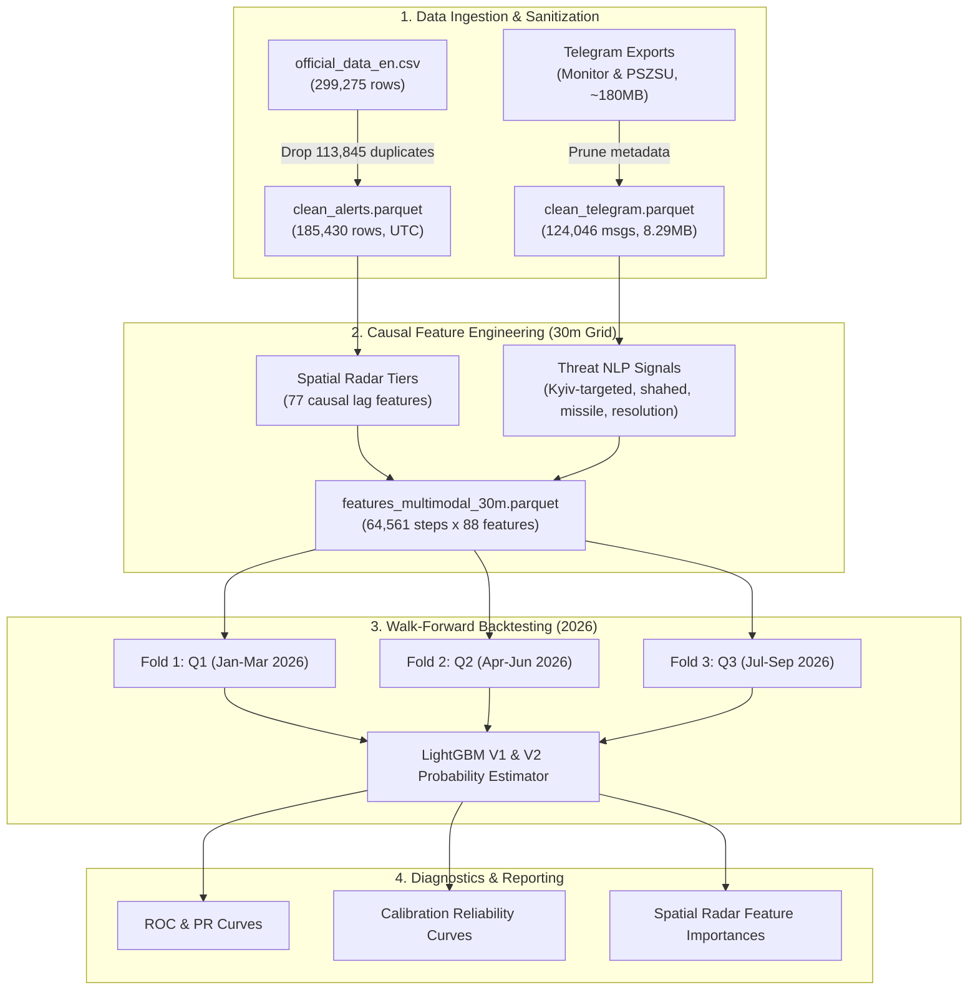

# SirenCast UA: Probabilistic Air Raid Alert Forecasting for Kyiv City

[](https://www.python.org/)
[](https://opensource.org/licenses/MIT)
[](https://kse.ua/)
[](tests/)

**SirenCast UA** is an end-to-end machine learning pipeline that forecasts air raid alert probabilities for **Kyiv City** on a 30-minute horizon ($[t, t + 30\text{min}]$).

The system integrates **4-tier spatial radar telemetry** across 25 Ukrainian oblasts with **causal NLP threat signals** parsed from over 124,000 real-time Telegram warnings (Monitor & Air Force Command of UA). All evaluations are performed under expanding-window **Walk-Forward temporal splits** across 2026 with strict causal hygiene ($t_{\text{input}} < t$).

---

## 🎯 Key Achievements & Benchmark Summary

Tested across expanding-window temporal folds in 2026 (**Fold 1:** Jan–Mar, **Fold 2:** Apr–Jun, **Fold 3:** Jul–Sep):

| Model Architecture | Input Modalities | 2026 Mean ROC-AUC | 2026 Mean PR-AUC | Brier Score (Calibration) |
| :--- | :--- | :---: | :---: | :---: |
| **Heuristic Baseline** | Kyivska Ring active siren rule | 0.7663 | 0.2208 | 0.1792 |
| **Logistic Regression** | L2 Regularized Spatial Lag Features | 0.8992 | 0.8039 | 0.0847 |
| **LightGBM V1** | 77 Causal Spatial Radar Features | **0.9021** | **0.8000** | **0.0339** |
| **LightGBM V2 (Multimodal)** | Spatial Radar + Telegram Threat NLP | **0.9037** | **0.8015** | **0.0339** |

* On **Fold 1 (Winter 2026 missile/drone campaign)**, Multimodal V2 boosted Active Alert ROC-AUC to **0.9167** and PR-AUC to **0.8255**.
* On **Alert Onset Prediction** (predicting the exact moment a new siren begins), text signals increased PR-AUC by **+21.4%** because aviation takeoffs (MiG-31K, Tu-95MS) and Shahed swarm vectors are announced on Telegram before physical sirens sound in Kyiv.

---

## 🏛️ System Architecture



---

## 🛰️ Spatial Radar Hierarchy

To predict threats heading towards Kyiv City, the feature store arranges regions into 4 concentric radar tiers:

1. **Tier 0 (Target Region):** Kyiv City local siren state, active duration, time since last clear.
2. **Tier 1 (Inner Ring - Kyivska Oblast Raions):** 7 surrounding raions (*Vyshhorodskyi, Brovarskyi, Boryspilskyi, Obukhivskyi, Fastivskyi, Buchanskyi, Bilotserkivskyi*).
3. **Tier 2 (Adjacent Oblasts):** 5 bordering oblasts (*Chernihivska, Sumska, Poltavska, Cherkaska, Zhytomyrska*).
4. **Tier 3 (Launch Corridors & Flanks):** Eastern missile corridor (*Kharkivska, Dnipropetrovska, Zaporizka*) & Southern sea/air launch flank (*Mykolaivska, Odeska, Khersonska*).
5. **Tier 4 (Macro Surge Speed):** Total nationwide active regions $N(t)$ and national rate of expansion $\Delta N = N(t) - N(t - 30\text{min})$.

---

## 🔍 Telegram NLP Threat Signals

* **Input Stream:** 124,046 messages from `@monitor` and `@kpszsu` (2023–2026).
* **Compression & Efficiency:** Pruned metadata (avatars, reactions, emoji markup), shrinking storage footprint from **~180 MB to 8.29 MB** (95.4% compression) in `data/clean_telegram.parquet`. Representative 50-message samples are included in `data/telegram/*_sample.json`.
* **Direction Matchers:** Specific targeting on Kyiv / surrounding hubs (`курсом на Київ`, `в напрямку Броварів`, `Васильків`, `Вишгород`).
* **Negation & Clearing Suppressors:** Suppresses signals when messages describe destructions or all-clears (`чисто`, `відбій`, `збито`, `дорозвідка`).
* **Experimental Embedding Finding:** Ablation experiments comparing dense topic embeddings (LSA: TF-IDF + TruncatedSVD) against directional regex filters revealed that **directional regex features generalize better across time** (average PR-AUC 0.8015 vs 0.7999). Deterministic flight vectors directly correlate with alerts, whereas dense latent vectors introduce noise from alerts in other regions.

---

## 📊 Diagnostic Visualizations

All generated diagnostic plots are exported to [`reports/figures/`](reports/figures/):
* `roc_curves_walk_forward.png`: ROC curves across Walk-Forward folds (0.9167 peak AUC).
* `pr_curves_walk_forward.png`: Precision-Recall curves illustrating trade-offs on class-imbalanced data.
* `calibration_curves.png`: Reliability diagrams confirming calibrated probabilities (Brier score: 0.0339).
* `feature_importance_top25.png`: Top features driving predictions (Inner ring raions, national surge speed, Kyiv-targeted Telegram warnings).
* `v1_vs_v2_comparison.png`: Ablation chart demonstrating multimodal performance gain.

---

## 🛠️ Quick Start & CLI Usage

### 1. Installation
```bash
git clone https://github.com/vkatsel/sirencast-ua.git
cd sirencast-ua
python -m venv .venv
source .venv/bin/activate  # On Windows: .venv\Scripts\activate
pip install -r requirements.txt
```

### 2. Run Comprehensive Test Suite (21 Tests)
```bash
python run_experiment.py --test
```

### 3. Run Pipeline Phases
```bash
# Execute end-to-end pipeline (Data Cleaning -> Spatial Features -> Multimodal -> Evaluation)
python run_experiment.py --phase all

# Or run individual phases:
python run_experiment.py --phase 1    # Data cleaning & deduplication
python run_experiment.py --phase 2    # 30-minute grid & spatial radar features
python run_experiment.py --phase 3    # Baseline models & Walk-Forward evaluation
python run_experiment.py --phase 4    # Multimodal Telegram NLP fusion
```
---

## 📜 License
Distributed under the MIT License. See `LICENSE` for more information.
