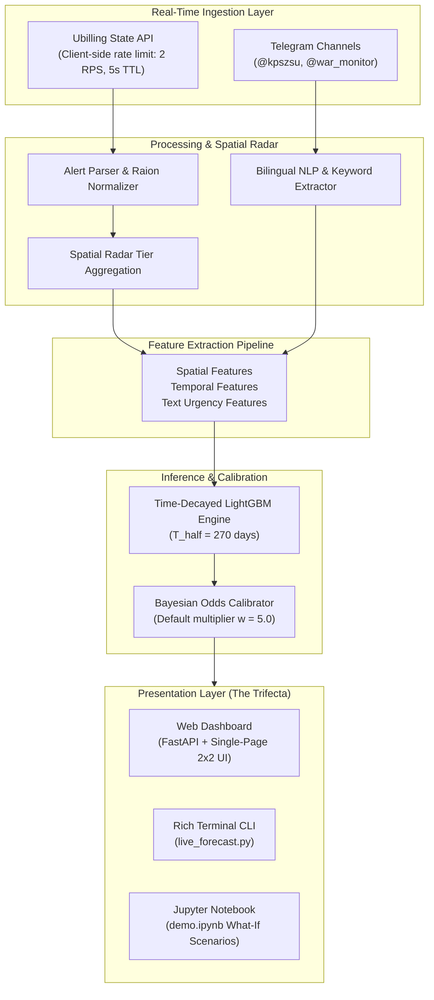

# SirenCast UA: System Architecture & Technical Specifications

> **Note**: This document is identical to [docs/specs.md](file:///D:/Projects/sirencast-ua/docs/specs.md). Please refer to either file for technical specifications.

## 1. System Overview & Objective

**SirenCast UA** is a real-time, short-horizon predictive modeling and situational awareness system designed for Kyiv, Ukraine. Its primary goal is to forecast whether an air raid alert will be declared in Kyiv City within the next 30 minutes ($t + 30\text{m}$), utilizing multimodal inputs:

1. **Official State Alert Feeds** (Ubilling API) covering all Ukrainian oblasts and districts (raions).
2. **Tactical OSINT & Early Warning Telegram Feeds** (Ukrainian Air Force `@kpszsu` and `@war_monitor`).
3. **Temporal Cyclical Dynamics** (diurnal patterns, day-of-week strike pacing).

The system addresses the fundamental domain imbalance between frequent quiet hours (~95% of operational time) and concentrated, high-consequence strike salvos through **exponential time-decay weighting**, **spatial radar corridor monitoring**, and **Bayesian odds calibration**.

---

## 2. Multi-Source Ingestion & Live Pipeline

### 2.1 State Alert API (`Ubilling`)
- **Endpoint**: Official JSON alert status feed for all oblasts and Kyiv raions.
- **Client-Side Rate Limiter**: 
  - Token-bucket / cooldown limiting: maximum **2 requests per second**, minimum **5-second TTL cache** to eliminate hammering and respect third-party server quotas.
  - Graceful fallback: cached state retention with offline mock generation for development and disconnected CI/CD test environments.

### 2.2 Tactical Telegram OSINT Feeds
- **Channels**: `@kpszsu` (Official Air Force Command) and `@war_monitor` (independent radar OSINT).
- **Time Windowing**: Analyzes posts within an active sliding window ($T_{\text{lookback}} = 60$ minutes; default query depth: 20 messages).
- **Text Cleaning & Normalization**: Strips decorative markdown, handles Cyrillic UTF-8 encoding safely across platforms, and matches tactical military lexicons.

---

## 3. Spatial Radar Hierarchy

Because air raid alerts in Ukraine propagate along specific threat axes (ballistic trajectories, cruise missile waypoints, and Shahed loitering drone routes), geographical proximity alone is insufficient. The spatial radar structure mirrors operational air defense reality:

| Radar Tier | Scope | Included Regions | Tactical Purpose |
| :--- | :--- | :--- | :--- |
| **Tier 0** | **Target Area** | Kyiv City (`м. Київ`) | Baseline state; predicts impending alarm if inactive, or continuation if active. |
| **Tier 1** | **Inner Ring (Kyiv Oblast Raions)** | 7 Raions: Bila Tserkva, Boryspil, Brovary, Bucha, Fastiv, Obukhiv, Vyshhorod | Immediate tactical perimeter. Alerts in 2+ inner raions indicate direct ingress toward Kyiv. |
| **Tier 2** | **Adjacent & Approach Corridors** | Chernihiv, Poltava, Cherkasy, Zhytomyr, Vinnytsia, and **Sumy** | Approach corridors. **Sumy** is included despite not physically bordering Kyivska oblast because it serves as the northeast ingress vector for ballistic/hypersonic launches from Kursk/Bryansk and Shahed swarms. |
| **Tier 3** | **Flank & Distant Corridors** | Dnipropetrovsk, Kharkiv, Kirovohrad, Mykolaiv, Odesa, Zaporizhzhia, etc. | Mid-range strike waves that often precede central capital alerts by 15–45 minutes. |
| **Tier 4** | **National Surge Indicator** | Percentage of all 25 Ukrainian regions currently under alert ($N_{\text{active}} / 25$) | Measures nationwide strike density (e.g., MiG-31K Kinzhal takeoff triggers 100% surge). |

---

## 4. Feature Engineering

The feature vector $\mathbf{x} \in \mathbb{R}^{D}$ combines 24 structured features across three distinct modalities:

### 4.1 Spatial Indicators
- `tier1_ratio`: Fraction of active Kyivska oblast raions ($0.0 \dots 1.0$).
- `tier2_ratio`: Fraction of active approach corridor oblasts ($0.0 \dots 1.0$).
- `tier3_ratio`: Fraction of active flank oblasts ($0.0 \dots 1.0$).
- `national_ratio`: Ratio of active regions across Ukraine ($0.0 \dots 1.0$).
- `tier1_active_count`, `tier2_active_count`: Discrete integer counts of active sectors.

### 4.2 Temporal & Diurnal Cyclical Signals
- `hour_sin`, `hour_cos`: Cyclical hour of day encoding ($\sin(2\pi h / 24)$, $\cos(2\pi h / 24)$).
- `day_sin`, `day_cos`: Cyclical day of week encoding.
- `is_night`: Binary flag indicating nocturnal drone attack window (22:00 to 06:00).
- `is_weekend`: Binary flag for weekend pacing.

### 4.3 Text Urgency & Threat Classification (NLP)
Extracted via high-precision compiled regular expressions with Ukrainian case inflection support:
- `ballistic_flag`: Mentions of ballistic/hypersonic threats (`балісти[кч]`, `іскандер`, `кинджал`, `циркон`, `с-300`, `с-400`).
- `aviation_flag`: Strategic aviation takeoffs (`ту-95`, `ту-22`, `міг-31`, `борт`, `зліт`).
- `shahed_flag`: Loitering munition waves (`шахед`, `бпла`, `безпілотник`, `мопед`, `герань`).
- `kyiv_targeted_flag`: Explicit vector towards the capital (`на київ`, `у напрямку києва`, `повз бровари`, `київщина`, `біла церква`).
- `threat_severity_score`: Ordinal composite scale ($0 \dots 3$) aggregating weapon class, volume, and trajectory.

---

## 5. Machine Learning Architecture & Time-Decay

### 5.1 Base Classifier: LightGBM
- **Model Type**: Gradient Boosted Decision Tree (`lightgbm.LGBMClassifier`).
- **Objective**: Binary Logloss (`binary`).
- **Hyperparameters**:
  - `n_estimators`: 250
  - `learning_rate`: 0.05
  - `num_leaves`: 31
  - `max_depth`: 6
  - `subsample`: 0.8
  - `colsample_bytree`: 0.8
  - `min_child_samples`: 20

### 5.2 Exponential Time-Decay Sample Weighting
Strike tactics and weapon distributions have fundamentally shifted between 2022 (cruise missile salvos) and 2024–2026 (mass nightly drone swarms + ballistic strikes). Training on unweighted historical data biases predictions toward obsolete patterns.

We apply an exponential time-decay weighting function to training instances:
$$w_i = \exp\left( -\frac{\ln(2)}{T_{\text{half}}} \cdot \Delta t_i \right)$$
where:
- $\Delta t_i = t_{\text{max}} - t_i$ is the age of sample $i$ in days relative to the latest observation.
- $T_{\text{half}} = 270\text{ days}$ (half-life of ~9 months).

**Effect**: Recent strike tactics carry the highest weight, preventing historical low-density periods from depressing modern situational risk estimates.

---

## 6. Probability Calibration & Operational Threat Index

### 6.1 The Base Rate Problem
In historical datasets spanning years, Kyiv is under alert approximately 5% of all 30-minute intervals. A standard logistic loss function outputs a mathematically sound uncalibrated posterior:
$$P_{\text{raw}} = P(Y=1 \mid \mathbf{x})$$
Under quiet conditions, $P_{\text{raw}} \approx 0.02 - 0.05$. Under an active approach wave (e.g., Shaheds in Chernihiv and Fastiv), $P_{\text{raw}}$ may rise to $0.20 - 0.25$. 

While a 5x increase represents an extreme surge, displaying "20%" to a user or emergency planner often causes confusion, as 20% sounds like a "low chance" despite impending danger.

### 6.2 Dual Operational Metric Architecture
To resolve this without corrupting statistical rigor, the system provides two distinct metrics:

1. **Calibrated Operational Threat Score ($P_{\text{calibrated}}$)**:
   Calculated using a configurable Bayesian odds multiplier $w$ (default $w = 5.0$):
   $$\text{Odds}_{\text{raw}} = \frac{P_{\text{raw}}}{1 - P_{\text{raw}}}$$
   $$\text{Odds}_{\text{calibrated}} = w \cdot \text{Odds}_{\text{raw}}$$
   $$P_{\text{calibrated}} = \frac{\text{Odds}_{\text{calibrated}}}{1 + \text{Odds}_{\text{calibrated}}}$$
   *Interpretation*: Transforms the raw statistical posterior into an operational action probability where 20% raw danger scales to ~55–60%, and 40% scales to >77%.

2. **Hazard Multiplier ($\times$ quiet baseline)**:
   $$M = \frac{P_{\text{raw}}}{P_{\text{baseline}}}$$
   where $P_{\text{baseline}} = 0.035$ (empirical quiet sky risk).
   *Interpretation*: A straightforward, intuitive fold-change metric (e.g., *"Risk is 6.5x higher than quiet baseline"*).

3. **Raw Statistical Probability ($P_{\text{raw}}$)**:
   Preserved and clearly exposed alongside calibration for technical audits, data scientists, and ROC-AUC evaluation.

---

## 7. Presentation Layer ("The Trifecta")

The system delivers real-time forecasts across three native interfaces:

### 7.1 Web Dashboard (`web/index.html` + `src/web.py`)
- **Single-Page 2x2 Viewport Layout**: Tailored for emergency monitors and operations displays without requiring vertical page scrolling on standard 1080p displays.
- **Bilingual Interface**: Seamless instant toggle between English (`EN`) and Ukrainian (`UA`) without reloading the page.
- **Reactive Components**:
  - **Hero Gauge**: Displays primary threat status, calibrated operational score, raw probability, and dynamic hazard badge.
  - **Threat Radar**: Live visual cards for Tier 1 Inner Ring, Tier 2 Approach Corridors, Tier 3 Flanks, and Tier 4 National Surge.
  - **AI Explanation & Decision Drivers**: Natural language breakdown of contributing factors (e.g., *"High national alert surge (68.0%)"*, *"Tactical mentions of ballistic weapons"*).
  - **Recent Early Warnings Feed**: Real-time Telegram OSINT cards with severity flags and timestamps.

### 7.2 Terminal Command Line Interface (`src/live_forecast.py`)
- **Rich-formatted Terminal Dashboard**: Built with the Python `rich` library.
- Displays live radar progress bars, odds-calibrated threat levels, and Telegram telemetry in the console with zero browser dependency.

### 7.3 Interactive Jupyter Notebook (`demo.ipynb`)
- **End-to-End Walkthrough**: Loads pretrained artifacts, connects to live feeds, runs synthetic "What-If" stress tests (Calm Day vs. Northeast Shahed Swarm vs. Mass Ballistic Salvo), and generates diagnostic comparison tables.
- Hardened with UTF-8 safe stream reconfiguration to prevent Windows Cyrillic codepage faults.

---

## 8. Verification & Quality Assurance

- **Test Suite**: 27 automated unit and integration tests (`tests/test_live.py`, `tests/test_models.py`, `tests/test_pipeline.py`).
- **Code Coverage**:
  - Rate limiting & cache TTL behavior.
  - Text normalization and case-insensitive regex parsing.
  - Spatial radar feature computation and raion aggregation.
  - Exponential time-decay weight decay slopes.
  - Bayesian odds calibration boundaries ($P \to 0 \implies 0$, $P \to 1 \implies 1$).
  - Web API endpoints and JSON serialization of NumPy/Pandas primitives.
